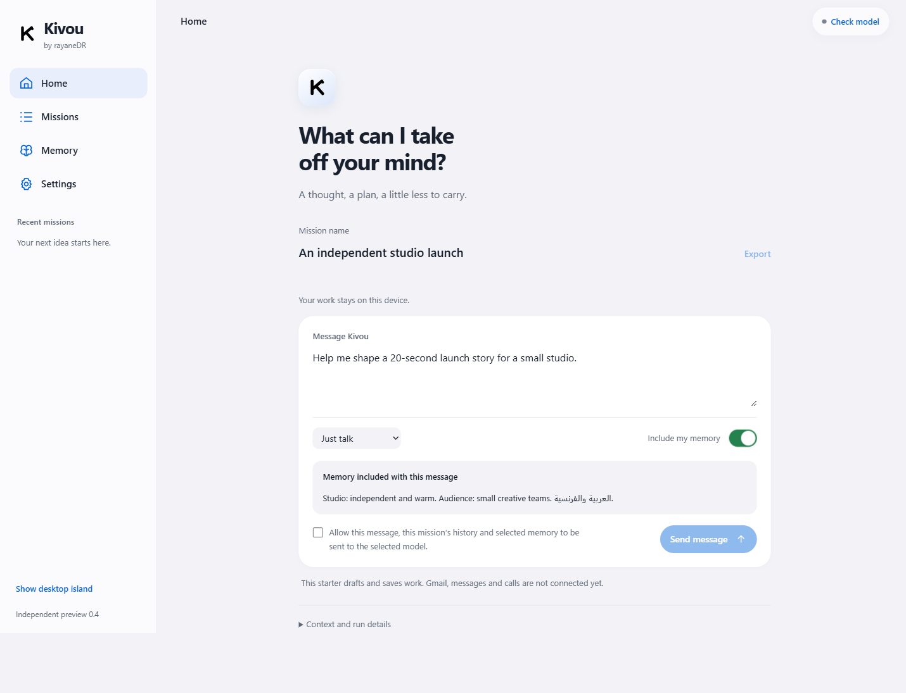

# Kivou

**A little presence. A useful next step.**

An independent Windows personal-assistant project by [rayaneDR](https://github.com/rayaneDR). The goal is a second brain that can work with your chosen model, remember selected context, and eventually complete connected tasks with clear permissions and receipts.

This is an early foundation, **not a released all-purpose autonomous agent**. The earlier Goose-based experiment has been replaced by an independent implementation in this workspace; none of its application source or runtime is used here.

[Build plan](PLAN.md) · [UI/UX research](docs/UX-RESEARCH.md) · [User reports and landscape](docs/RESEARCH.md) · [Capability matrix](replica/features.csv)



## What works in this starter

- Original Node.js engine and sandboxed Electron workspace.
- Local missions with explicit memory inclusion, saved conversation and run receipts.
- One active model run; cancellation, interrupted-state recovery and retained partial output.
- Direct connection to an installed Codex CLI using the user's ChatGPT login; one actual model cycle recorded separately from synthetic tests.
- iOS-inspired Home, Missions, Memory and Settings, with floating bottom navigation on narrow windows, grouped controls, dark mode and reduced-transparency support.
- Small 264 × 48 native desktop island, quick messages, Stop run and keyboard-focus restoration.
- Local search and non-overwriting Markdown/JSON export bundles.

The OpenAI-compatible, Anthropic, Gemini and Ollama adapters have synthetic protocol tests. The settings UI is implemented and tested with a synthetic key encrypted/decrypted through actual Windows secure storage. Live non-Codex provider/account compatibility remains unverified. No paid API requests were made.

Gmail, MCP tools, sending messages, phone calls and scheduled external actions are **planned, not connected**. The first proposed integration is inbox catch-up with source-linked summaries and separately reviewed replies. Kivou does not inherit the development chat's connected accounts.

## Run the foundation

Windows x64, Node.js 24+, and a current installed Codex CLI signed in with ChatGPT:

```powershell
npm ci
npm test
npm start
```

If your npm policy skips Electron's install script, run `node node_modules/electron/install.js`. In Kivou, check the connection, enter a mission and message, then explicitly allow the model request. Your account's model access and usage limits apply; no paid fallback is selected automatically.

Closing a window hides it. Use the system tray's **Quit Kivou** to exit. `Ctrl + Alt + K` toggles the island when Windows grants the shortcut. This independent preview uses a separate `Kivou Independent` application-data folder, preserving the old experiment's data.

## Data and limitations

Missions and memory are local plain-text JSON; they are not a protected credential vault. Selected context is sent to the chosen provider only for an allowed request. API keys belong in Windows secure storage, outside mission records and exports. Review exports before sharing them: they include conversation and selected-memory snapshots.

This preview drafts and exports. Model-generated claims are not independently verified. It has no external-action tools and does not claim feature parity with established agents. Long-history performance, full keyboard/focus behavior, packaged launch and independent release verification remain work in progress.

## Checks

`npm test` exercises lifecycle, memory isolation, recovery, export integrity and provider protocol/secret boundaries using synthetic fixtures. `node scripts/desktop-smoke.mjs` exercises the actual development application with an isolated test profile. A model call is real only when the evidence explicitly records one. `qa/desktop-smoke.json` records final UI/secure-storage checks without model calls; `qa/desktop-model.json` records an earlier actual UI model cycle and reopen; `qa/provider-live.json` records the separate real core/provider request. The independent executable has not yet been built or released.

MIT · [Third-party notices](THIRD-PARTY-NOTICES.md). Electron and DM Sans retain their licenses. External model software, subscriptions and services remain subject to their providers' terms.
