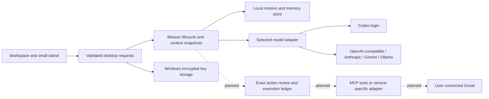

# Independent Kivou architecture

The current code is a starter, not the complete personal-agent system. No Goose application code, binary, ACP bridge or Git history is imported. Ordinary third-party libraries keep their licenses.

## Current implementation

`core/store.mjs` owns bounded local state and preserves a corrupt original instead of silently resetting it. Writes use a unique sibling temporary file followed by rename. Restarted running missions become interrupted; saved partial text remains. The current preview still snapshots all saved missions to its own renderer: long-history pagination is required before claiming heavy-use scalability.

`core/engine.mjs` owns one active run, explicit consent, selected-memory snapshots, bounded context, terminal status, partial results and non-overwriting exports. Cancellation wins over a late success. It does not execute external-action tools.

`core/provider.mjs` calls the separately installed Codex CLI in an empty application-owned scratch folder. It ignores inherited user configuration, excludes API-key/provider environment overrides, disables unrelated apps/plugins/hooks/shell/browser/computer features, and uses read-only execution. A real model request completed on the development machine. This is not a formal security audit or a guarantee of compatibility with every CLI version.

`core/api-provider.mjs` defines explicit HTTP protocols and bounded responses. It forbids credentials in endpoint URLs, rejects redirects, and permits plain HTTP only for loopback servers. Protocol fixture tests cover OpenAI-compatible chat completions, Anthropic Messages, Gemini generateContent and Ollama chat. They do not establish real third-party account/model access.

`core/provider-settings.mjs` separates encrypted keys from mission data, refuses a plaintext fallback when the vault is unavailable, and prevents a changed endpoint from inheriting another endpoint's key. Electron supplies Windows safeStorage. The complete settings screen passed actual desktop checks, including native Windows encryption/decryption of a synthetic key and absence of that key in renderer snapshots/mission data. Unit tests separately use a synthetic vault. No non-Codex paid provider request was made.

`desktop/main.cjs` owns native windows, dialogs, trusted data paths and an IPC allowlist. Requests are accepted only from an owned top-level frame. The island cannot invoke workspace-only settings/export operations. Renderers are sandboxed with context isolation and no Node integration. Content uses text nodes; remote navigation/windows are denied. The prototype has no in-app external browser.

## Planned action runtime

An action record needs a tool identity, account/scope, exact target and payload digest, authorization identity/time/expiry, attempt identifier and observed outcome. A model may propose an action; only the host validates scope and executes an adapter. Changed payload invalidates approval. Denial is terminal for that proposal.

MCP is a tools transport, not a replacement for a model connection. A future MCP client must initialize/discover capabilities, validate schemas, bound tool results and track cancellation. Server annotations are hints, not proof that a tool is harmless. Unknown/write tools require review until an explicit scoped policy exists. Connecting a server does not authorize every action it exposes.

For email, a timeout after dispatch is an **uncertain outcome**, not a safe retry. Persist intent before dispatch, reconcile sent records/provider receipts, and do not claim exactly-once delivery from a local idempotency key alone. The first adapter should support Gmail read-only catch-up before sending.

Public email distribution may require OAuth app setup/verification. Calling requires a telephony service, user identity/region eligibility, explicit call authorization and actual provider cost. No connector or paid fallback is silently provisioned from the owner's existing development accounts.

## Acceptance order

1. Core lifecycle and source independence.
2. Model/credential setup with configured versus live-tested status.
3. Real Gmail account, bounded read and source-linked summary.
4. Exact reply review, denied/expired/changed approval tests, one actual send receipt.
5. Reconciliation after an ambiguous send failure, revoke/disconnect and restart tests.
6. Native focus/display performance and verified portable executable.
7. Accurate screenshots, Remotion demo and public release matching the capability matrix.
